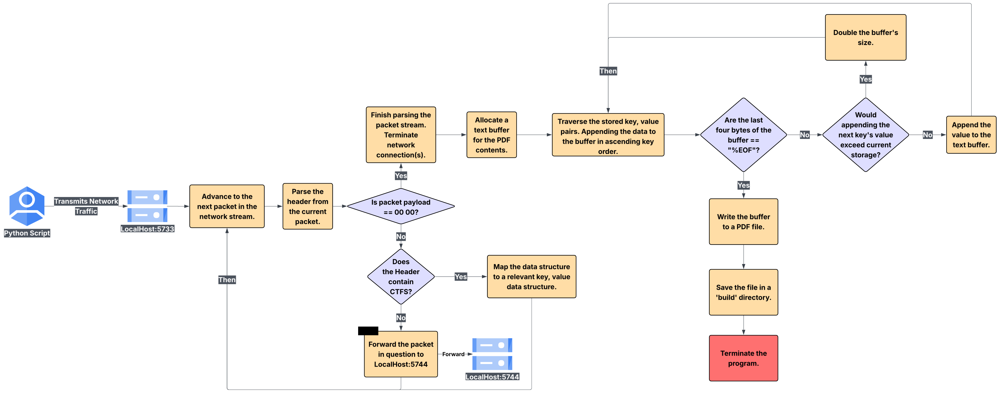
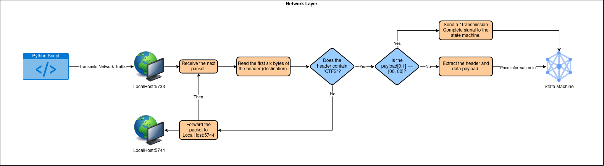

# Design

This contains details regarding system architecture, including trade-offs & design decisions made during development.

> System Flow Chart

Above is an initial interpretation of what this system must represent, error checking/ handling will be implemented around the processes described in the chart to ensure accurate parsing and manipulation of data, this is subject to change as the project develops, but will continue to be included as a reflection of the starting perspective on the task.

The below elaborations represent their final form, and may be described differently to what the initial System Flow Chart Describes (Namely the "State Machine").

## System Architecture

After following the initial mapping of System Architecture, the logical groupings of the project best fit into the following descriptions.

### NetworkManager

> Network Layer

This layer handles all incoming traffic from `PORT 5733`. Here the listening socket is created and configured with the following options.
| `setsockopt()` parameter | Option | Justification |
|---|---|---|
|__level|SOL_SOCKET|The option applies at the socket level.|
|__optname|SO_REUSEADDR|Allows the program to rebind 5733 without flagging "address in use" errors.|

| `sockaddr_in` member | Option | Justification |
|---|---|---|
|`sin_family`|`AF_INET`|Uses standard IPv4 family|
|`sin_port`|`htons(5733)`|Listening port is `5733`, put in network order for readability by the system.|
|`sin_addr.s_addr`|`INADDR_ANY`|Accepts messages from any incoming IPv4 interface.|

After accepting `recv()` calls into the 32kb `holding` buffer, the buffer is given the Packet Framer for parsing (`framer.cpp`).

### PacketFramer

Packet headers are parsed and handled using a feedback enum `Result`, allowing the framer to convey its status and have its issue resolved by the program. For example, a packet that is split between `recv()` calls can be completed by calling `Status::NeedMore` to accept more data from the byte stream into `holding`. The same is done for complete packets, returning a signal that corresponds to a forwarding of the packet, or `mapping` that is done by the `handler.cpp` functionality.

This can be visualised as logic that splices the start and end of packets from the unfiltered stream of data allowed in by the network handler.

### Handler

The planned state machine's multi-purpose design reduced during development, this led to the change of name to "handler" since the logical grouping no longer had use of a typical state machine.

Its components consist of a `map` and `build` functionality, storing key-value paired items until the terminator (empty payload CTFS header) is received signifying the end of communications. `Build` then assembles the PDF with the given components.

