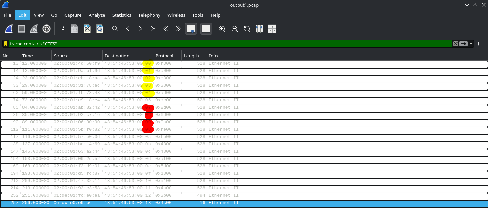

# Protocol

This includes information regarding the network protocol used to transmit packets, primarily gleaned from analysing the `output.pcap` file using [WireShark](https://www.wireshark.org/). Code snippets such as `eth.dst` refer to object names displayed by the WireShark GUI, and may not be applicable to standard networking libraries like POSIX headers etc.

> [!IMPORTANT] 
> It is worth noting that while the doc comments that a header may contain 10 bytes such that the 8-10th byte may represent `x`, these are indexed from 0 and should be treated as such if trying to access the `nth` byte in a packet stream (E.g. byte 10 of `packet` would be found at `packet[9]` OR `packet[i - 1]`).

As mentioned in the problem spec, the *CTFS* tag signifies a relevant packet. This is found within the six-byte *Destination Hardware Address* (`eth.dst`). Upon inspection this always contains the ASCII code "CTFS  ", or `43 54 46 53 00 00` in hexadecimal. Unlike the forwarded transmission types, the *CTFS* tags throw an 'unknown' `eth.type` result from WireShark, these desired packets will be referred to as *CTFS Packets*.

Other transmissions to be forwarded tend to contain an `0x0800` corresponding to an `eth.type` of IPv4.

## Header Format

In chronological order, the following table outlines the structure of CTFS packet headers:

**Frame Structure:**
| Name | Size (bytes) | Range (byte(s)) |
|---|---|---|
| Header | 16 | 0 - 15 |
| Data | <= 512 | 16 - 527 |

**Header Structure:**
| Component Name | Alias | Size (bytes) | Range (byte(s)) |
|---|---|---|---|
| IG bit | `eth.dst.ig` | 3 | 0 - 2 |
| Destination | `eth.dst` | 6 | 0 - 5 |
| IG bit | `eth.src.ig` | 3 | 6 - 8 |
| Source | `eth.src` | 6 | 6 - 11 |
| Type | `eth.type` | 2 | 12 - 14 | 

To signal the end of a CTFS transmission, a packet with an empty payload are sent as a stop signal. 

> [!NOTE]
> If analysing the network traffic using WireShark, due to the unknown nature of this *CTFS* protocol the two-byte `00 00` padding is included within the data payload. This is misleading as the reconstructed PDF document would not align/ format properly if NULL chunks were present at the intersection of each packet's contents.

In order to retain the order of packets and form a valid PDF, the incremental value hidden in the `eth.dst` header (See *yellow* values) can be used to track the position of each packet. This protects from cases of connection interference where packets are received out of sequential order (See *red* values), which is visible in the test data.

> Retaining Packet Order
###
